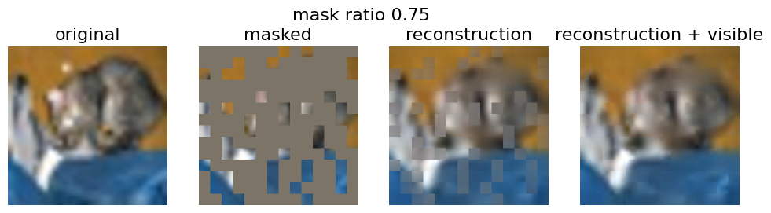
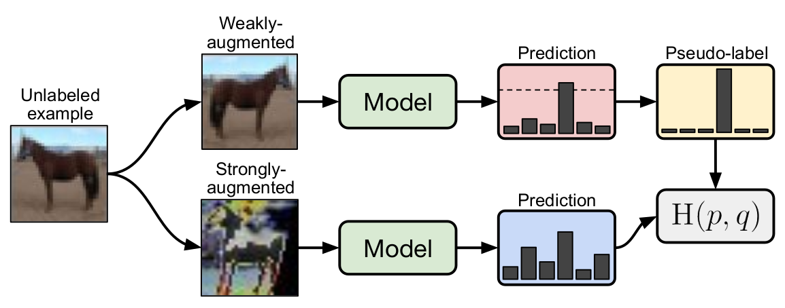
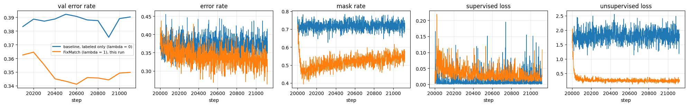

# Learning with Few Labels: SimCLR, Masked Autoencoders & FixMatch

Three ways to learn from **unlabelled** images, implemented and trained on CIFAR-10:

- **SimCLR**: contrastive self-supervised learning (JAX/Flax)
- **MAE**: a Vision Transformer masked autoencoder (PyTorch)
- **FixMatch**: semi-supervised learning with pseudo-labels (JAX)

> Practical assignment for **DD2412 Deep Learning, Advanced Course** at KTH Royal Institute of Technology. The course provided the notebook scaffolding, data pipelines and the FixMatch baseline checkpoint and logs. I implemented the core components (losses, attention, the ViT/MAE forward passes, the FixMatch objective), the extra experiments and diagnostics, and the analysis.

**Stack:** JAX 0.4.38 · Flax 0.10.4 · Optax 0.2.4 · `jax-resnet` · PyTorch 2.x · torchvision · TensorBoard. Trained on Google Colab GPUs.

---

## Table of Contents

- [Contents](#contents)
- [1. SimCLR: contrastive self-supervised learning](#1-simclr-contrastive-self-supervised-learning)
  - [Concept](#concept)
  - [Architecture](#architecture)
  - [What I implemented](#what-i-implemented)
  - [Results](#results)
- [2. Masked Autoencoder (MAE) with a Vision Transformer](#2-masked-autoencoder-mae-with-a-vision-transformer)
  - [Concept](#concept-1)
  - [Architecture (47.6 M parameters)](#architecture-476-m-parameters)
  - [What I implemented](#what-i-implemented-1)
  - [Results](#results-1)
- [3. FixMatch: semi-supervised learning](#3-fixmatch-semi-supervised-learning)
  - [Concept](#concept-2)
  - [Architecture and setup](#architecture-and-setup)
  - [What I implemented](#what-i-implemented-2)
  - [Results](#results-2)
- [Bonus: synthetic data for extremely low-label learning (implemented, not yet run)](#bonus-synthetic-data-for-extremely-low-label-learning-implemented-not-yet-run)
- [Running](#running)
- [References](#references)

---

## Contents

| Notebook | Method | Framework |
|---|---|---|
| [`01_SimCLR_contrastive_learning.ipynb`](notebooks/01_SimCLR_contrastive_learning.ipynb) | SimCLR with NT-Xent loss, a representation-collapse experiment, linear evaluation | JAX / Flax |
| [`02_MAE_masked_autoencoder.ipynb`](notebooks/02_MAE_masked_autoencoder.ipynb) | ViT and MAE from scratch, mask-ratio study, positional-encoding ablation | PyTorch |
| [`03_FixMatch_semi_supervised.ipynb`](notebooks/03_FixMatch_semi_supervised.ipynb) | FixMatch loss, cosine LR schedule, comparison with a labelled-only baseline | JAX |
| [`bonus/`](bonus/) | Multi-GPU (DDP) pipeline: class-conditional diffusion → synthetic labels for FashionMNIST with 0.1 % of the labels (**implemented, not yet run**) | PyTorch + 🤗 diffusers |

---

## 1. SimCLR: contrastive self-supervised learning

### Concept
Two random augmentations of the same image form a **positive pair**. Every other image in the batch is a **negative**. The **NT-Xent** loss pulls positive pairs together and pushes negatives apart, using cosine similarity:

```
ℓ(i, j) = −log  exp(sim(zᵢ, zⱼ)/τ) / Σ_{k≠i} exp(sim(zᵢ, z_k)/τ)
```

### Architecture
`CIFAR-10 image → 2 augmented views → ResNet-18 encoder (global avg-pool) → projection head Dense(128) → ReLU → Dense(128) → NT-Xent (τ = 0.07)`.
After pre-training, the projection head is dropped and the encoder is frozen. A linear classifier is then trained on top (**linear evaluation protocol**).

### What I implemented
- Cosine similarity and the **NT-Xent loss**, fully vectorised over a `[2N × 2N]` similarity matrix with the diagonal masked out. I checked it against a loop-based reference at several temperatures.
- A **positives-only loss**, to show why negatives are necessary.
- A diagnostic that measures **representation collapse** (cosine similarity between *different* images).

### Results
Pre-training: 5 epochs, batch 128, SGD with momentum. The loss fell from 3.19 to 0.10.

| Encoder | Mean cos-sim between *different* images | Per-dim std of embeddings |
|---|---|---|
| Random initialisation | 0.959 | 0.017 |
| **SimCLR (NT-Xent)** | **0.006** | **0.088** (≈ random unit vectors on the sphere) |
| Positives-only loss | 0.996 → **collapsed** | 0.006 |

- Without negatives, the network maps every image to the same vector: **representation collapse**. NT-Xent spreads the embeddings uniformly over the sphere.
- Linear probe with **1 % of the labels** (500 images): **24 % validation accuracy** after 5 pre-training epochs (the reference value for 20 epochs is 25 %). The notebook explains the gap to the paper: far fewer epochs (5 vs. up to 1,000), batch 128 instead of 4,096, and no random-resized-crop augmentation.

---

## 2. Masked Autoencoder (MAE) with a Vision Transformer

### Concept
The image is split into 16×16 patches and **75 % of them are randomly masked**. The encoder sees only the visible patches. A lightweight decoder reconstructs the missing pixels, and the MSE loss is computed **on the masked patches only**.

### Architecture (47.6 M parameters)
```
224×224 image → PatchEmbed (conv 16×16, stride 16) → 196 tokens + pos-embed
  → random masking (keep 49 tokens)
  → ViT encoder: 12 blocks, dim 384, 6 heads   (pre-norm MHSA + MLP, residuals)
  → Linear → 512 + learned [MASK] tokens, unshuffle → decoder pos-embed
  → ViT decoder: 8 blocks, dim 512, 16 heads
  → Linear → 16·16·3 pixels per patch
```

### What I implemented
`PatchEmbed`, **multi-head self-attention** (`softmax(QKᵀ/√d)·V`), the MLP block, the encoder and decoder forward passes (mask tokens and `gather`-based unshuffling), the masked-patch loss, fixed **2-D sine-cosine positional encodings**, and a positional-encoding ablation.

### Results
Trained for 20 epochs on CIFAR-10 (upsampled to 224 px), about 1.5 h on a Colab T4.



**Effect of the mask ratio at test time** (masked-patch MSE on 512 test images):

| Mask ratio | Visible patches | MSE |
|---|---|---|
| 0.50 | 98 | 0.038 |
| 0.75 (train) | 49 | 0.104 |
| 0.85 | 29 | 0.195 |
| 0.95 | 9 | 0.508 |

**Positional-encoding ablation** (10 epochs each, same seed and masks):

| Positional encoding | MSE @ 0.75 | Final train loss |
|---|---|---|
| Learned | 0.125 | 0.084 |
| **Fixed 2-D sin-cos** | **0.114** | **0.075** |
| None | 0.880 (fails) | 0.812 |

Without positional encodings, every mask token is identical and attention is permutation-equivariant. The decoder therefore produces the same flat grey patch everywhere. Fixed sin-cos encodings beat learned ones by about 9 % at this short training budget.

---

## 3. FixMatch: semi-supervised learning



### Concept
For each unlabelled image, the model's prediction on a **weakly augmented** view (flip + shift) becomes a **hard pseudo-label**, but only if its confidence is at least τ = 0.95. The model is then trained to predict that pseudo-label on a **strongly augmented** view (RandAugment + Cutout):

```
L = L_s(labelled) + λ · (1/μB) Σ 1[max p(y|weak) ≥ τ] · CE(argmax p(y|weak), p(y|strong))
```

### Architecture and setup
ResNet-18 (`jax-resnet`), 4,000 labelled CIFAR-10 images (400 per class), all 50k images used as unlabelled data, μ = 7 (64 labelled + 448 unlabelled images per batch), SGD with momentum 0.9, cosine LR decay `η·cos(7πk/16K)`, weight decay 5e-6.

### What I implemented
Log-softmax cross-entropy, the cosine-decay schedule, a single fused forward pass over `[labelled | weak | strong]` with BatchNorm state, the **FixMatch loss** (stop-gradient on the pseudo-labels, confidence mask, L2 penalty), and the validation loop.

### Results
Resumed from a provided 20k-step labelled-only checkpoint and trained for 1,120 more steps, compared over the same steps with a baseline that uses no unlabelled loss (λ = 0):

| Model | Val error (mean of last 3) | Best val error |
|---|---|---|
| Labelled only (λ = 0) | 0.385 | 0.375 |
| **FixMatch (λ = 1)** | **0.348** | **0.341** |

FixMatch lowered the validation error by **about 3.5–4 percentage points** within about 12 minutes of training. The baseline overfits its 4k labels (supervised loss ≈ 0), while FixMatch's unsupervised loss keeps it improving.



---

## Bonus: synthetic data for extremely low-label learning (implemented, not yet run)

[`bonus/bonus_synthetic_fmnist.py`](bonus/bonus_synthetic_fmnist.py) is a multi-GPU (PyTorch DDP) pipeline for FashionMNIST with **only 60 labels (0.1 %)**:
1. Baselines: supervised-only, FixMatch, SimCLR + linear probe, MAE + linear probe.
2. Fine-tune the pretrained DDPM `google/ddpm-cifar10-32` into a **class-conditional diffusion model**. Training uses the labels plus confident FixMatch pseudo-labels, with classifier-free guidance.
3. Sample 1,000 images per class with DDIM, filter out samples whose label the classifier disputes, and retrain the classifiers on real + synthetic data.

The code is complete, but it needs a multi-GPU node and **has not been executed yet**, so there are no results for it. See [`bonus/run_bonus.sbatch`](bonus/run_bonus.sbatch) for the SLURM launcher.

---

## Running

The notebooks are written for **Google Colab (GPU runtime)**. Each one starts with a setup cell that pins the library versions. CIFAR-10 downloads automatically.

- FixMatch also needs `notebooks/src/utils.py` and `notebooks/jaxlog-base/` (the baseline TensorBoard logs), both included here. It downloads the 20k-step checkpoint automatically with `gdown`.
- All notebooks are committed **with their outputs**, so you can read the results on GitHub without running anything.

## References

1. Chen et al., *A Simple Framework for Contrastive Learning of Visual Representations* (SimCLR), ICML 2020.
2. He et al., *Masked Autoencoders Are Scalable Vision Learners*, CVPR 2022.
3. Dosovitskiy et al., *An Image is Worth 16x16 Words* (ViT), ICLR 2021.
4. Sohn et al., *FixMatch: Simplifying Semi-Supervised Learning with Consistency and Confidence*, NeurIPS 2020.
5. Ho, Jain & Abbeel, *Denoising Diffusion Probabilistic Models*, NeurIPS 2020.
